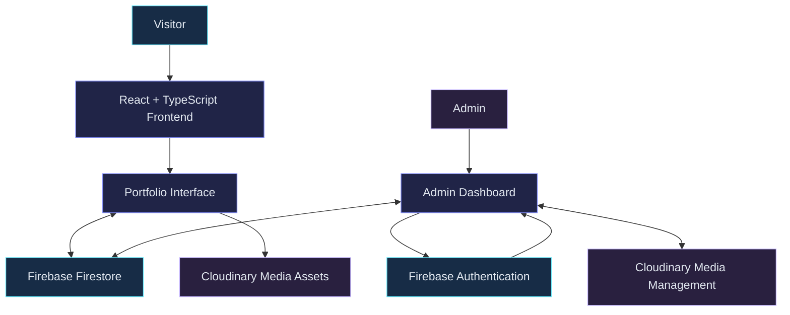

 
<div align="center">


<br/>

<a href="https://fathima-saheera.web.app">
  
</a>
<a href="https://github.com/Saheera-006">
  
</a>
<a href="https://www.linkedin.com/in/fathima-saheera">
  
</a>

<br/><br/>


</div>

## ✦ 01 — PROJECT OVERVIEW

A personal portfolio developed to showcase my technical skills, projects, experience, education, and development journey through an interactive digital experience.

Built with **React, TypeScript, and Vite**, this portfolio goes beyond a static website. It integrates Firebase and Cloudinary to support dynamic content management, media handling, and a dedicated Admin CMS.

<div align="center">

<a href="https://fathima-saheera.web.app">
  **↗ Explore the Live Portfolio**
</a>

</div>

### Highlights

- Cinematic dark-themed interface.
- Interactive character and animated storytelling.
- Dynamic content powered by Firebase Firestore.
- Cloudinary-based image and media management.
- Dedicated Admin CMS.
- Responsive project archive and project details.
- Separate certificates page.
- Smooth transitions and scroll-triggered animations.

---

## ✦ 02 — DESIGN & EXPERIENCE

The visual direction combines a cinematic dark interface with cool blue accents, subtle gradients, and interactive motion.

| Feature | Description |
|---|---|
| Cinematic Background | Animated visual atmosphere |
| Interactive Character | Custom character integrated into the experience |
| Story Journey | Visual storytelling of my development journey |
| Motion Effects | Smooth transitions and scroll-based animations |
| Project Rail | Horizontal featured project navigation |
| Responsive UI | Adaptable desktop and mobile layouts |

### Interactive Project Rail

The featured projects section uses a horizontal scrolling layout.

- Desktop: Mouse-wheel gestures move the project rail horizontally.
- Trackpad: Supports horizontal scrolling.
- Mobile: Swipe navigation.
- Keyboard: Arrow-key navigation when focused.
- Normal vertical page scrolling works outside the rail.

---

## ✦ 03 — TECHNOLOGY STACK

<div align="center">

**Frontend Development**


<br/><br/>

**Backend & Cloud**


<br/>


<br/><br/>

**Development Tools**


<br/><br/>


</div>

---

## ✦ 04 — APPLICATION ARCHITECTURE

The portfolio combines a React-based frontend with Firebase cloud services and Cloudinary media management.



### Cloud Services

| Service | Purpose |
|---|---|
| Firebase Authentication | Admin authentication |
| Cloud Firestore | Dynamic content storage |
| Firebase Hosting | Website deployment |
| Cloudinary | Image and media management |

### Content Flow

1. Admin accesses the dedicated dashboard.
2. Firebase Authentication handles admin sign-in.
3. Portfolio information is managed through the CMS.
4. Images and media are managed through Cloudinary.
5. Dynamic content is stored and retrieved through Firestore.
6. The frontend displays the updated portfolio content.

---

## ✦ 05 — ADMIN CMS

A dedicated content management system makes it possible to maintain portfolio information without manually editing source code for every content update.

| Module | Management |
|---|---|
| Profile | Personal and professional information |
| Projects | Project details and descriptions |
| Skills | Technical skill information |
| Education | Academic details |
| Experience | Internship and experience information |
| Certificates | Certification information |
| Media | Image uploads and media management |

The CMS separates content management from frontend presentation, making the portfolio easier to maintain and extend.

---

## ✦ 06 — APPLICATION ROUTES

| Route | Description |
|---|---|
| `/` | Cinematic homepage |
| `/projects` | Full project archive |
| `/certificates` | Dedicated certificates page |
| `/admin` | Admin dashboard |

### Latest Homepage Improvements

- Removed certification previews from the homepage while retaining the dedicated certificates page.
- Introduced a horizontal featured projects rail.
- Preserved existing project data and project details modal.
- Retained the live-site notice functionality.
- Maintained the full projects archive.
- Kept `esbuild` on `^0.28.2` to align with the Vite version's peer dependency requirements.

---

## ✦ 07 — FEATURED PROJECTS

### 01. Dynamoz26

**Symposium Registration & Event Platform**

A React and Firebase-powered symposium platform developed for the Computer Science and Engineering Department at University College of Engineering Nagercoil.

- Event information and online registration.
- Firebase-powered registration management.
- Admin dashboard for submissions.
- Registration tracking and data export.

### 02. Artify

**Creative Design Submission & Evaluation Platform**

A creative submission and evaluation platform developed for Dynamoz'26.

- Online creative design submissions.
- AI-assisted evaluation using Google Gemini API.
- Multi-round evaluation workflow.
- Admin dashboard.
- CSV export for submissions and evaluation data.

<div align="center">

<a href="https://artify26.web.app">
  
</a>

</div>

---

## ✦ 08 — PROJECT STRUCTURE

```text
portfolio/
│
├── public/
│   └── Fathima_Saheera_Resume.html
│
├── src/
│   ├── assets/
│   │   └── images/
│   │
│   ├── components/
│   │   ├── HeroSection.tsx
│   │   ├── CinematicBackground.tsx
│   │   ├── HeroCharacter.tsx
│   │   ├── AboutCinematic.tsx
│   │   ├── StoryJourneySection.tsx
│   │   ├── ProjectsSection.tsx
│   │   ├── SkillsConstellation.tsx
│   │   ├── ExperienceSection.tsx
│   │   ├── CertificationsSection.tsx
│   │   ├── ContactSection.tsx
│   │   └── admin/
│   │       ├── AdminDashboard.tsx
│   │       ├── AdminLogin.tsx
│   │       ├── ImageUploader.tsx
│   │       └── CloudStorageSettings.tsx
│   │
│   ├── context/
│   │   └── PortfolioContext.tsx
│   │
│   ├── data/
│   │   └── portfolioData.ts
│   │
│   ├── hooks/
│   ├── lib/
│   │   ├── firebase.ts
│   │   ├── portfolioService.ts
│   │   └── storageService.ts
│   │
│   ├── pages/
│   │   ├── ProjectsPage.tsx
│   │   └── CertificatesPage.tsx
│   │
│   ├── utils/
│   ├── App.tsx
│   ├── index.css
│   └── main.tsx
│
├── .env.example
├── firebase.json
├── firestore.rules
├── package.json
├── tsconfig.json
└── vite.config.ts
```

---

## ✦ 09 — RUN LOCALLY

**Prerequisites:** Node.js, npm, and Git.

### Clone the repository

```bash
git clone https://github.com/Saheera-006/fathima-saheera-portfolio.git
```

### Navigate into the project

```bash
cd fathima-saheera-portfolio
```

### Install dependencies

```bash
npm install
```

### Start the development server

```bash
npm run dev
```

Open the local URL printed by Vite. The development server uses port `3000`.

### Production build

```bash
npm run build
```

### Lint check

```bash
npm run lint
```

### Configuration

- Use `.env.example` as the configuration reference.
- Configure Firebase and Cloudinary settings for their integrated features.
- Never commit private environment files or secret credentials.
- `.env*` files are excluded through `.gitignore`.

---

## ✦ 10 — GITHUB ACTIVITY

<div align="center">

**Contribution Statistics**


<br/><br/>

**Contribution Streak**


<br/><br/>

**Contribution Graph**


<br/>


</div>

---

## ✦ 11 — WHAT I LEARNED

Building this portfolio gave me practical experience in:

- Component-based frontend architecture.
- TypeScript with React.
- Firebase Authentication and Firestore integration.
- Cloudinary-based media management.
- Admin CMS development.
- Dynamic content management.
- Responsive UI and interactive experiences.
- Animation and scroll-based interactions.
- Deploying and maintaining a live application.

---

## ✦ 12 — CONNECT WITH ME

<div align="center">

<a href="https://github.com/Saheera-006">
  
</a>
<a href="https://www.linkedin.com/in/fathima-saheera">
  
</a>
<a href="https://fathima-saheera.web.app">
  
</a>

<br/><br/>

### THANK YOU FOR VISITING!

*Ideas become experiences when creativity meets engineering.*

<br/>


</div>
