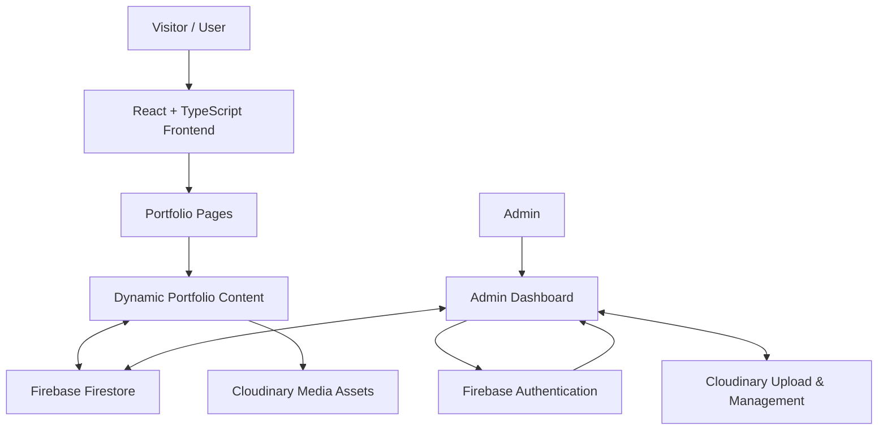

 
<div align="center">

# FATHIMA SAHEERA

### ASPIRING FULL STACK DEVELOPER


<br/>

<a href="https://fathima-saheera.web.app">
  
</a>
<a href="https://github.com/Saheera-006">
  
</a>
<a href="https://www.linkedin.com/in/fathima-saheera">
  
</a>

<br/><br/>


</div>

## `01` — ABOUT THE PROJECT

A personal portfolio built to showcase my development journey, technical skills, projects, experience, and achievements through an interactive digital experience.

This isn't just a static portfolio website. It is a dynamic, cloud-integrated web application with a dedicated Admin CMS, allowing portfolio content and media to be managed without manually modifying the source code for every update.

**Live Website:** [fathima-saheera.web.app](https://fathima-saheera.web.app/)

### Project Highlights

- Cinematic, dark-themed visual experience.
- Interactive character and animated storytelling.
- Dynamic portfolio content powered by Firebase.
- Cloudinary integration for image and media management.
- Dedicated Admin CMS for content management.
- Responsive project archive and detailed project views.
- Separate certificates page.
- Custom animations and interactive UI elements.

---

## `02` — DESIGN & USER EXPERIENCE

The portfolio is designed around a cinematic, futuristic visual identity with a dark navy background and cool blue accents.

### Interactive Experience

- **Cinematic Background** — Animated visual atmosphere throughout the website.
- **Interactive Character** — A custom character integrated into the portfolio experience.
- **Motion Effects** — Smooth transitions and scroll-triggered animations.
- **Story Journey** — A visual presentation of my learning and development journey.
- **Responsive Interface** — Adaptable layouts for desktop and mobile devices.
- **Custom Interactions** — Interactive elements designed to make navigation more engaging.

### Project Showcase

The featured projects section uses a horizontal project rail.

- Desktop mouse-wheel gestures move the rail horizontally.
- Trackpads support horizontal scrolling.
- Mobile users can swipe through projects.
- Keyboard users can navigate using arrow keys.
- Normal vertical page scrolling remains available outside the rail.

---

## `03` — TECHNOLOGY STACK

Technologies and tools used to develop the portfolio.

<div align="center">

### Frontend


### Backend & Cloud Services


<br/>


### Development Tools


<br/>


</div>

---

## `04` — APPLICATION ARCHITECTURE

The application combines a React-based frontend with Firebase cloud services and Cloudinary media management.



### Cloud Integration

| Service | Responsibility |
|---|---|
| Firebase Authentication | Admin authentication |
| Cloud Firestore | Dynamic portfolio content storage |
| Firebase Hosting | Hosting and deployment |
| Cloudinary | Image and media storage and delivery |

### How Content Management Works

1. The admin accesses the protected admin dashboard.
2. Firebase Authentication handles admin sign-in.
3. The admin manages portfolio information through the CMS.
4. Images and media are handled through Cloudinary.
5. Portfolio content is stored and retrieved using Firestore.
6. The frontend displays the available portfolio content dynamically.

---

## `05` — ADMIN CMS

A dedicated content management system is integrated into the portfolio to simplify content updates.

### CMS Capabilities

| Module | Functionality |
|---|---|
| Profile | Manage personal and professional information |
| Projects | Add, edit, and manage project details |
| Skills | Maintain technical skills |
| Education | Manage academic information |
| Experience | Update internship and experience details |
| Certificates | Manage certification information |
| Media | Upload and manage images through Cloudinary |

The CMS separates content management from the frontend presentation, making the portfolio easier to maintain and extend.

---

## `06` — APPLICATION ROUTES

| Route | Description |
|---|---|
| `/` | Cinematic portfolio homepage |
| `/projects` | Complete project archive |
| `/certificates` | Dedicated certificates page |
| `/admin` | Admin dashboard |

### Latest Homepage Improvements

- Removed certification previews from the homepage while retaining the separate certificates page.
- Introduced a horizontal featured projects rail.
- Preserved existing project data and project details modal.
- Retained the live-site notice functionality.
- Maintained the full projects archive.
- Kept `esbuild` on `^0.28.2` to align with the Vite version's peer dependency requirements.

---

## `07` — FEATURED PROJECTS

### Dynamoz26

**Symposium Registration & Event Platform**

A React and Firebase-powered symposium website developed for the Computer Science and Engineering Department at University College of Engineering Nagercoil.

- Event information and registration.
- Online participant registration.
- Firebase-powered data management.
- Admin dashboard for viewing and managing submissions.
- Registration tracking and data export.

### Artify

**Creative Design Submission & Evaluation Platform**

A creative design submission and evaluation platform developed for Dynamoz'26.

- Online design submissions.
- AI-assisted evaluation using Google Gemini API.
- Multi-round evaluation workflow.
- Admin dashboard.
- CSV export for submissions and evaluation data.

<a href="https://artify26.web.app">
  
</a>

---

## `08` — PROJECT STRUCTURE

```text
portfolio/
│
├── public/
│   └── Fathima_Saheera_Resume.html
│
├── src/
│   ├── assets/
│   │   └── images/
│   │
│   ├── components/
│   │   ├── HeroSection.tsx
│   │   ├── CinematicBackground.tsx
│   │   ├── HeroCharacter.tsx
│   │   ├── AboutCinematic.tsx
│   │   ├── StoryJourneySection.tsx
│   │   ├── ProjectsSection.tsx
│   │   ├── SkillsConstellation.tsx
│   │   ├── ExperienceSection.tsx
│   │   ├── CertificationsSection.tsx
│   │   ├── ContactSection.tsx
│   │   └── admin/
│   │       ├── AdminDashboard.tsx
│   │       ├── AdminLogin.tsx
│   │       ├── ImageUploader.tsx
│   │       └── CloudStorageSettings.tsx
│   │
│   ├── context/
│   │   └── PortfolioContext.tsx
│   │
│   ├── data/
│   │   └── portfolioData.ts
│   │
│   ├── hooks/
│   ├── lib/
│   │   ├── firebase.ts
│   │   ├── portfolioService.ts
│   │   └── storageService.ts
│   │
│   ├── pages/
│   │   ├── ProjectsPage.tsx
│   │   └── CertificatesPage.tsx
│   │
│   ├── utils/
│   ├── App.tsx
│   ├── index.css
│   └── main.tsx
│
├── .env.example
├── firebase.json
├── firestore.rules
├── package.json
├── tsconfig.json
└── vite.config.ts
```

---

## `09` — RUN LOCALLY

### Prerequisites

- Node.js
- npm
- Git

### 1. Clone the repository

```bash
git clone https://github.com/Saheera-006/fathima-saheera-portfolio.git
```

### 2. Navigate to the project

```bash
cd fathima-saheera-portfolio
```

### 3. Install dependencies

```bash
npm install
```

### 4. Start development server

```bash
npm run dev
```

Open the local URL printed by Vite. The development server uses port `3000`.

### 5. Build for production

```bash
npm run build
```

### 6. Run lint checks

```bash
npm run lint
```

**Configuration:** Use `.env.example` as a reference for environment variables. Configure the required Firebase and Cloudinary settings before using their integrated features. Never commit private credentials or secret keys.

---

## `10` — GITHUB ACTIVITY

<div align="center">

### Contribution Statistics


<br/><br/>

### Contribution Streak


<br/><br/>

### Contribution Graph


<br/>


</div>

---

## `11` — WHAT I LEARNED

Building this portfolio helped me explore and apply:

- Component-based frontend architecture.
- TypeScript in a real-world React application.
- Firebase authentication and cloud database integration.
- Cloudinary-based media management.
- Admin CMS design and dynamic content handling.
- Responsive layouts and interactive user experiences.
- Animation and scroll-based interactions.
- Deployment and maintenance of a live web application.

---

## `12` — CONNECT WITH ME

<div align="center">

<a href="https://github.com/Saheera-006">
  
</a>
<a href="https://www.linkedin.com/in/fathima-saheera">
  
</a>
<a href="https://fathima-saheera.web.app">
  
</a>

<br/><br/>

### THANK YOU FOR VISITING!

*Building ideas into applications, one step at a time.*


</div>
